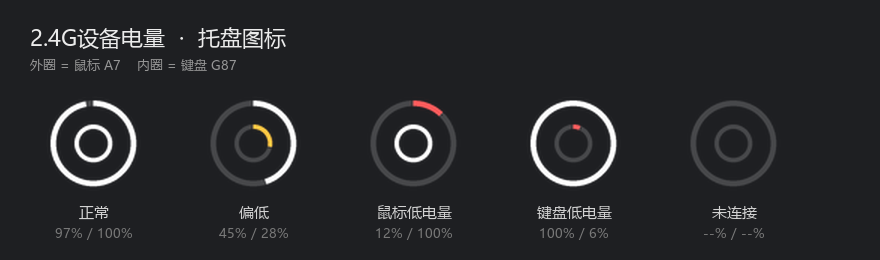

# 2.4G设备电量

> 迈从 A7 鼠标 + G87 键盘的电量托盘监控，只占**一个**托盘图标，跟系统图标融为一体。



Windows 自带的「电池电量低」提醒只认笔记本电池，2.4G 外设根本不在它的视野里。
这个工具直接读设备的 HID 私有协议，把电量塞进任务栏。

## 特性

- **只有一个托盘图标**：外圈鼠标、内圈键盘，细线风格跟系统图标一致
- 跟随系统浅色/深色主题自动切换黑白
- 平时纯白，**≤30% 变黄、≤15% 变红**
- 悬停显示两个设备的百分比
- 任意设备 **≤10%** 弹一次托盘通知（回充后重置）
- 绿色免安装，单文件 exe，不写注册表、不联网、不写日志
- 空闲 CPU 占用 ≈ 0.03%，内存约 40 MB

## 快速开始

### 方式一：直接跑源码

```bash
pip install hidapi pillow pystray
python mchose_battery.py
```

### 方式二：打包成 exe（推荐）

```bash
pip install pyinstaller
pyinstaller --noconsole --onefile --name "2.4G设备电量" --icon app.ico ^
  --version-file version_info.txt --collect-all hidapi mchose_battery.py
```

产物在 `dist\2.4G设备电量.exe`，双击即用，不依赖 Python 环境。

> 注意：Windows「设置 → 任务栏 → 其他系统托盘图标」里显示的名字，读的是 exe 的版本信息
> `FileDescription`。直接跑 `.py` 只会显示「Python」——所以想要正确的名字必须打包，
> `version_info.txt` 就是干这个的。

## 用法

- 双击 exe 常驻托盘，**每小时**读一次电量（源码里 `REFRESH_SEC` 可改）
- 双击图标 → 立即刷新
- 右键 → 立即刷新 / 开机自启 / 退出

## 协议

> 逆向自官方网页驱动 [mchose.com.cn](https://www.mchose.com.cn/)。它本身用 WebHID
> （`navigator.hid`）明文收发 HID 报文，协议就是从打包后的前端代码里还原出来的。
> 两台设备方案不同，协议完全不一样。

### A7 鼠标（VID `0x5253` / PID `0x1021`，RealTek 方案）

- 接口 `usagePage 0xFF01`，Feature Report `0x11`，长度 **65**
- 查询：`SetFeature(0x11, [F9, FF, FF…])`，即命令 `0x0600` 按位取反，其余填 `0xFF`
  - ⚠️ 必须发满 65 字节，发 20 字节会被系统拒绝（错误码 87）
- 回包：65 字节，**去掉前 2 字节后逐字节 XOR 0xFF**，第 **11** 字节 = 电量 %

```
11 f9 ac ad 8f ff f9 fa fc fd f6 9e ff 62 ff …
   ↓ 去前两字节 + XOR FF
53 52 70 00 06 05 03 02 09 61 00 62 …
   ↑ vid      ↑ pid      ↑ 第11字节 = 0x62 = 98%
```

### G87 键盘（VID `0x41E4` / PID `0x2001`，Compx 方案）

- 接口 `usagePage 0xFF02`，reportId `0x13`
- 发送命令（20 字节）：

  ```
  13 4a 01 00 00 00 00 00 00 00 00 00 00 00 00 00 00 00 00
  ```

- 响应：`13 4a 01 00 02 34 01 …`，第 **5** 字节 = 电量 %（例：`0x34` = 52%）
- 命令来自官方网页驱动 `configManagerMap` 里的 `getBattery.wirelessCommand`

> ⚠️ **别用 `0xFF04` 的 Feature Report `0x06`**。它返回 `06 00 02 64 64 64`，
> 那三个 `0x64` 是**满电容量**，不是实时电量。满电时两者碰巧都是 100，
> 掉电后就会一直错误地显示 100%（早期版本踩过这个坑）。
>
> 另外：设备深度休眠时 `0xFF02` 命令通道不响应，此时显示 `--`，属正常。

### 适配其他设备

1. `hid.enumerate(vid)` 找到该设备的私有接口（`usage_page` 为 `0xFFxx`）
2. 用 hidapi / node-hid 把 Feature / Output Report 全试一遍，看哪个能读回数据
3. 官方网页驱动就是现成的协议说明书：打开它页面按 F12，控制台会打
   `[webHID:发送] reportId:… payload:…` 的十六进制日志

## 文件说明

| 文件 | 用途 |
|---|---|
| `mchose_battery.py` | 主程序 |
| `icon.ico` | 托盘图标资源 |
| `app.ico` | exe 图标（深色圆角底） |
| `version_info.txt` | exe 版本信息（决定托盘设置里的名字） |
| `assets/preview.png` | 说明图 |

## 已知限制

- 只支持 A7 / G87，协议是逐型号逆向的，换设备要重新逆
- 设备休眠或没连上时显示 `--`，保留上次读数
- G87 满电时回包第 3/4/5 字节都是 `0x64`，等电量掉下去才能确认哪个才是真正的百分比字段；
  如果发现键盘读数不准，把 `read_g87()` 的 `resp[3]` 换成 `resp[4]` 或 `resp[5]` 试试

## 免责声明

私有协议通过分析厂商网页驱动的公开前端代码得到，仅供学习与个人使用。
与迈从（MCHOSE）官方无关，不保证适配其他型号或固件版本。
